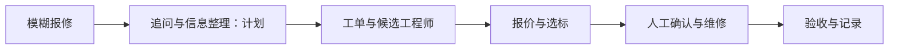

# Lab Repair Agent · 科研仪器维修协作

**从一句“仪器坏了”，走向三方都能理解和推进的维修流程。**

A laboratory-instrument repair workflow foundation for users, engineers, and service coordinators. Agent capabilities are on the roadmap.

## 项目的起点

用户描述故障，工程师判断能否承接，协调方组织报价和进度。同一件事在不同角色之间传递时，容易缺少设备信息、诊断依据或明确的下一步。这个项目从维修小程序演进，尝试把这些协作环节放进可追踪的流程。

**核心讨论：一个维修 Agent 应该推进到哪一步，哪些判断必须由人完成？**

## 已有源码

- Express / Sequelize / MySQL 后端。
- Vue 管理后台与 uni-app 用户、工程师界面。
- 设备与工单、工程师匹配、竞标报价和选标流程。
- 维修协调方（broker）、权限、业务记录及相关管理模块。
- 支付和结算相关业务模块；本公开快照不等于已经完成真实支付接入验证。

这是业务流程基础的开发预览。**LLM 故障追问、自动解释报价与 Agent 工具编排是后续计划，当前不宣称已实现。**

## 本地开发

需要 Node.js 20+ 与 MySQL 8。仅在本地新建名为 `lab_repair_demo` 的空数据库，然后：

```bash
cd backend
npm ci
# 将 .env.example 复制为 .env，填入自己的本地数据库账号。
# 设置至少 32 字符的 JWT_SECRET、至少 12 字符的 ADMIN_PASSWORD。
node init-demo.js
npm start
```

另开终端启动后台：

```bash
cd admin
npm ci
npm run dev
```

小程序或 H5：

```bash
cd miniprogram
npm ci
npm run dev:h5
# 微信构建：npm run build:mp-weixin
```

微信账号、对象存储等服务需要自行配置。`init-demo.js` 仅接受本地演示数据库，不删除数据库或覆盖现有账号。公开版不携带客户、真实工单、原数据库、附件和固定演示密码。数据库完整业务链路仍需独立环境验证。

## Agent 演进方向



- **信息完整性**：把故障描述整理成工程师可以接手的信息包。
- **匹配可解释性**：展示技能、区域等匹配依据与缺失信息。
- **报价可比较性**：解释人工、配件和服务范围，不仅比较总价。
- **角色边界**：将建议与执行分开，报价确认、工程操作和验收保留人工判断。

## 路线图

- [ ] 合成报修案例与可复现的全流程演示。
- [ ] 故障信息提取和追问 Agent。
- [ ] 带权限检查与幂等控制的 Agent 工具接口。
- [ ] 报价解释与流程停滞提醒。
- [ ] 公开评测任务完成率、追问质量和错误动作率。

欢迎提交一个“明明有工单却推进不下去”的场景，并指出哪一方缺少什么信息。参见 [贡献说明](CONTRIBUTING.md) 与 [公开版范围](docs/PUBLIC_EDITION.md)。

MIT License。依赖遵循各自许可。

## 同一条仪器生命周期

配套项目：[huaboshi-instrument-agent](https://github.com/2137183172-cyber/huaboshi-instrument-agent)。两个项目分别探索仪器选型与维修协作。

[验证记录](docs/VALIDATION.md) · [参与讨论](https://github.com/2137183172-cyber/lab-repair-agent/discussions)
